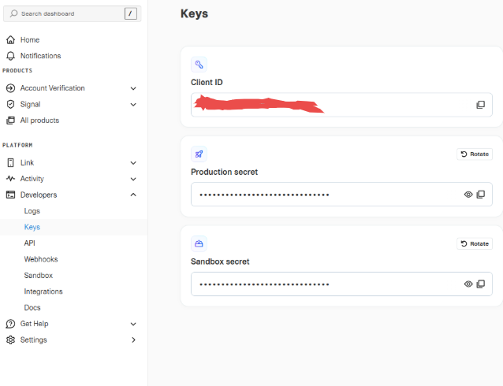

.. image:: https://odoo-community.org/readme-banner-image
   :target: https://odoo-community.org/get-involved?utm_source=readme
   :alt: Odoo Community Association

=================================
Online Bank Statements: plaid.com
=================================

.. 
   !!!!!!!!!!!!!!!!!!!!!!!!!!!!!!!!!!!!!!!!!!!!!!!!!!!!
   !! This file is generated by oca-gen-addon-readme !!
   !! changes will be overwritten.                   !!
   !!!!!!!!!!!!!!!!!!!!!!!!!!!!!!!!!!!!!!!!!!!!!!!!!!!!
   !! source digest: sha256:d8f7f3d2306506a5fa26fe43e687b03a74b900daedce04d69984c59aee89400c
   !!!!!!!!!!!!!!!!!!!!!!!!!!!!!!!!!!!!!!!!!!!!!!!!!!!!

.. |badge1| image:: https://img.shields.io/badge/maturity-Beta-yellow.png
    :target: https://odoo-community.org/page/development-status
    :alt: Beta
.. |badge2| image:: https://img.shields.io/badge/license-AGPL--3-blue.png
    :target: http://www.gnu.org/licenses/agpl-3.0-standalone.html
    :alt: License: AGPL-3
.. |badge3| image:: https://img.shields.io/badge/github-OCA%2Fbank--statement--import-lightgray.png?logo=github
    :target: https://github.com/OCA/bank-statement-import/tree/19.0/account_statement_import_online_plaid
    :alt: OCA/bank-statement-import
.. |badge4| image:: https://img.shields.io/badge/weblate-Translate%20me-F47D42.png
    :target: https://translation.odoo-community.org/projects/bank-statement-import-19-0/bank-statement-import-19-0-account_statement_import_online_plaid
    :alt: Translate me on Weblate
.. |badge5| image:: https://img.shields.io/badge/runboat-Try%20me-875A7B.png
    :target: https://runboat.odoo-community.org/builds?repo=OCA/bank-statement-import&target_branch=19.0
    :alt: Try me on Runboat

|badge1| |badge2| |badge3| |badge4| |badge5|

This module provides online bank statements from Plaid.com, supporting
both Sandbox and Production environments.

**Table of contents**

.. contents::
   :local:

Configuration
=============

To configure online bank statements provider:

1. Go to *Invoicing > Configuration > Bank Accounts*
2. Open bank account to configure and edit it
3. Set *Bank Feeds* to *Online*
4. Select *Plaid.com* as online bank statements provider in *Online Bank
   Statements (OCA)* section
5. Save the bank account
6. Click on provider and configure provider-specific settings.

or, alternatively:

1. Go to *Invoicing > Overview*
2. Open settings of the corresponding journal account
3. Switch to *Bank Account* tab
4. Set *Bank Feeds* to *Online*
5. Select *Plaid.com* as online bank statements provider in *Online Bank
   Statements (OCA)* section
6. Save the bank account
7. Click on provider and configure provider-specific settings.

Plaid Account & Credentials
---------------------------

To obtain the necessary credentials (*Client ID* and *Secret*), follow
these steps:

1. **Create a Plaid Account**: Go to
   `dashboard.plaid.com/signup <https://dashboard.plaid.com/signup>`__
   and sign up for a developer account.

2. **Get Credentials**: Once logged in, navigate to **Platform >
   Developers > Keys** in the Plaid Dashboard. Here you will find your
   **Client ID** and **Secret**.

   |Plaid Keys Dashboard|

   .. note::

      There are different secrets for **Sandbox** (testing) and
      **Production** (live) environments. Make sure to copy the secret
      corresponding to the environment you intend to use.

   .. important::

      **Account Approval Times:**

      - For **US-based companies**, approval typically takes **1-2
        business days**.
      - For **companies outside the United States**, the approval
        process may take longer.

Configuration in Odoo
---------------------

When configuring the provider in Odoo, map the Plaid credentials as
follows:

- **Username**: Enter your Plaid **Client ID**.
- **Password**: Enter your Plaid **Secret** (Sandbox or Production).
- **Plaid Environment**: Select **Sandbox** for testing or
  **Production** for live data.

Then click **Link with Plaid** and log in to the bank in the Plaid
window. If the login has several accounts (checking, savings, a credit
card), choose the one for this journal. **Choose Account** changes it
later.

Several accounts at one bank
----------------------------

Plaid bills per bank login. To import a second account from a login that
is already linked, for example a credit card at the same bank as the
checking account, create its provider and set **Use Plaid Login Of** to
the first provider instead of entering credentials. Then choose its
account.

Expired logins and unlinking
----------------------------

When the bank asks for a new password or a new consent, pulls fail with
a message to reconnect. Click **Reconnect Bank** to repair the login
without creating a new one. **Unlink from Plaid** removes the login at
Plaid, which ends its billing; imported transactions are kept.

Check also ``account_bank_statement_import_online`` configuration
instructions for more information.

Usage
=====

To pull historical bank statements:

1. Go to *Invoicing > Configuration > Bank Accounts*
2. Select specific bank accounts
3. Configure username, password and host for plaid
4. Click *Link with Plaid* and choose the account
5. After launch *Actions > Online Bank Statements Pull Wizard*
6. Configure date interval and click *Pull*

If historical data is not needed, then just simply wait for the
scheduled activity "Pull Online Bank Statements" to be executed for
getting new transactions.

Changelog
=========

19.0.1.0.0
----------

- Migration to 19.0.
- Import only the account chosen for the journal. A Plaid login can hold
  several accounts, which were all imported into the same journal.
- Leave out pending transactions, which get a new ID once posted and
  were imported twice.
- Keep the bank's transaction dates in the provider's timezone.
- Fetch the whole pull range from Plaid once, instead of once per
  statement period.
- Scheduled pulls look back 14 days (*Plaid Lookback*), so transactions
  that post a few days after their date are not missed.
- Share one Plaid login between providers (*Use Plaid Login Of*).
- *Reconnect Bank* opens Link in update mode for expired logins. *Unlink
  from Plaid* removes the login at Plaid.
- The access token is readable by administrators only.
- Load Plaid Link from Plaid's CDN, as Plaid requires, instead of a
  bundled copy.

Bug Tracker
===========

Bugs are tracked on `GitHub Issues <https://github.com/OCA/bank-statement-import/issues>`_.
In case of trouble, please check there if your issue has already been reported.
If you spotted it first, help us to smash it by providing a detailed and welcomed
`feedback <https://github.com/OCA/bank-statement-import/issues/new?body=module:%20account_statement_import_online_plaid%0Aversion:%2019.0%0A%0A**Steps%20to%20reproduce**%0A-%20...%0A%0A**Current%20behavior**%0A%0A**Expected%20behavior**>`_.

Do not contact contributors directly about support or help with technical issues.

Credits
=======

Authors
-------

* Binhex

Contributors
------------

- `Binhex <https://binhex.cloud>`__:

  - Adasat Torres de León <a.torres@binhex.cloud>
  - Rolando Rebollo \\ <rrebollo@binhex.cloud>
  - Antonio Ruban \\ <a.ruban@binhex.cloud>

Maintainers
-----------

This module is maintained by the OCA.

.. image:: https://odoo-community.org/logo.png
   :alt: Odoo Community Association
   :target: https://odoo-community.org

OCA, or the Odoo Community Association, is a nonprofit organization whose
mission is to support the collaborative development of Odoo features and
promote its widespread use.

This module is part of the `OCA/bank-statement-import <https://github.com/OCA/bank-statement-import/tree/19.0/account_statement_import_online_plaid>`_ project on GitHub.

You are welcome to contribute. To learn how please visit https://odoo-community.org/page/Contribute.
